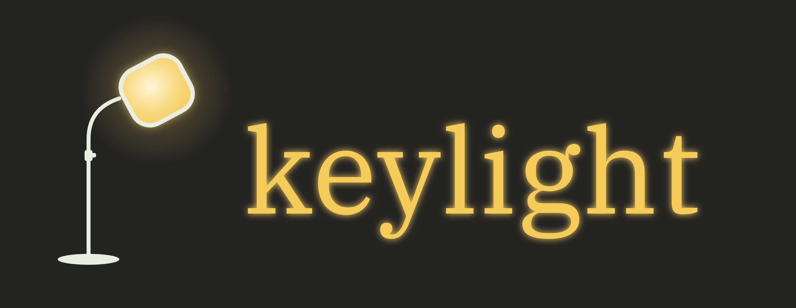

<p align="center"></p>

# Keylight

**Your screen can get brighter than white. Keylight uses that extra brightness only where it matters.**

Keylight is an accessibility-focused prototype for video, built at Cal Hacks 13.0. It finds the subject of each scene, follows it through the shot, and lights it the way a cinematographer's *key light* would. On an HDR display (such as a MacBook Pro's XDR screen) the subject is rendered **above SDR reference white**, using brightness the video itself never uses. The background stays as it was filmed.

It is aimed at people with reduced contrast sensitivity (for example from macular degeneration), who can see the screen but lose the subject in dark or busy scenes. Normal brightness and contrast controls change the whole frame, so the background brightens along with the subject. Keylight changes only the subject.

> **Status: prototype.** Keylight has not been tested with low-vision users, and none of its benefits are clinically validated. Processing happens before playback; it is not real time.

## What's in this branch

| Piece | What it does | State |
|---|---|---|
| **Web app** (`./scripts/start.sh`, localhost:8000) | Upload or drop a video, processes it, plays a before/after **wipe** and an attention view. Plays an HDR10 version on HDR-capable browsers, SDR elsewhere | Working |
| **Native Metal player** (`native/KeylightPlayer`) | macOS app that renders the subject live in Extended Dynamic Range on the XDR display. Library with **Add video**, rename, delete; wipe, attention view, brightness slider, calibration screen | Working on an M3 Pro |
| **SAM 2 segmentation** (`segmentation_backend: sam2`) | YOLO proposes objects about once a second; SAM 2.1 traces and follows them for tighter, steadier masks | Working, offline only (slow) |
| **Claude subject choice** | "What should Keylight follow?" Claude picks which tracked object matters per shot | Working with an API key; optional |

## How it works

```
video ─► PERCEPTION ─────────► UNDERSTANDING ──────► TEMPORAL ATTENTION ──────► RENDERING
         where is everything?  what matters?         how should focus move?    light the subject
         YOLO11n-seg+ByteTrack Claude, on ~1 fps     per-shot target, weights  SDR video, HDR10 video,
         or YOLO + SAM 2.1     keyframes with        smoothed with ≤1 s        or live Metal EDR
         + scene-cut detection numbered objects      lookahead, never across                (background untouched)
                                                     a cut
```

**Where vs. what.** YOLO and SAM 2 decide *where* each object is, frame by frame. Claude decides *which* object deserves attention: each keyframe is sent with every tracked object's ID drawn on it (set-of-mark prompting), plus the viewer's instruction if there is one ("the cyclist in red"). Claude must answer with one of those IDs or the answer is rejected. Without a key, or on any failure, a local heuristic (object class, size, how central and how persistent it is) chooses instead.

**Temporal attention.** A subject that flickers on and off is worse than none. Each object's weight is smoothed with a window that looks up to one second ahead, so focus starts moving *before* a new subject takes over, and never blends across a scene cut. Hysteresis and a minimum dwell time stop it from jumping between similar objects.

**HDR color management.** Decoded BT.709 video is converted to linear light (BT.1886), to BT.2020 primaries, and placed so SDR white = 203 nits (the ITU reference). The subject is then lifted (about 2.2× at the default strength) with a soft roll-off from 500 nits, capped at 1,000 nits, and encoded as 10-bit HEVC with the PQ curve. Apple's hardware encoder drops the HDR color labels, so they are rewritten in the bitstream and checked after every encode. The "original" in every comparison goes through the same path and encoder settings from the same decoded frames, so the comparison is fair: away from the subject, Keylight's frames are the original's frames, unchanged.

**Native EDR.** The Metal player draws into an extended-range, linear-light layer where 1.0 is SDR white and values above it use the display's live EDR headroom (which grows as you lower screen brightness). Video frames come from AVFoundation, the precomputed per-frame masks are memory-mapped, and one fragment shader applies the lift. Masks are precomputed; the lighting is rendered live.

## Measured results

On a MacBook Pro M3 Pro (MPS), from [`EXPERIMENT.md`](EXPERIMENT.md). Two clips; evidence, not proof.

**Night drive** (97 frames, 1080p; SAM 2 running on every frame):

| | YOLO11n-seg + ByteTrack | YOLO keyframes + SAM 2.1 Tiny |
|---|---|---|
| Mask stability (consecutive-frame IoU, mean) | 0.960 | **0.983** |
| Edge alignment (higher = mask edge sits on the real edge) | 5.72 | **7.11** |
| Speed | **9.8 fps** | 0.83 fps |
| Peak memory | **681 MB** | 1,139 MB |

**Person walking** (689 frames, 1080×1920; SAM 2 at ~15 Hz on up to 3 objects, the current default):

| | YOLO | YOLO + SAM 2.1 Tiny |
|---|---|---|
| Edge alignment | 2.15 | **3.27** |
| Speed | **35.7 fps** | 2.05 fps |

The trade-off: SAM 2 gives visibly tighter, steadier masks at roughly 12 to 17 times the processing time. YOLO stays the default; SAM 2 is the "precise masks" option for videos you prepare ahead of time.

## How it differs from existing work

| | What it does | Keylight's difference |
|---|---|---|
| Peli lab, Schepens Eye Research Institute (2007–08) | Contrast enhancement in a TV decoder for viewers with low vision; people with macular degeneration preferred it | Their enhancement applies to the whole picture. Keylight changes only the subject and uses HDR headroom to do it |
| Sony BRAVIA XR "focal point" | The TV's processor detects the picture's focal point and uses it to process the image | Built into Sony TVs for picture quality; the viewer can't direct it. Keylight is user-directed, runs on any video file, and is built for accessibility |
| NVIDIA RTX Video HDR | AI converts SDR web video to HDR on RTX GPUs | Improves the look of the whole video; it doesn't choose a subject |

## Run it (macOS, Apple Silicon)

```bash
./scripts/setup.sh                   # once: Python venv, models, UI build
./scripts/start.sh                   # web app + engine on http://localhost:8000
```

Native Metal player (Xcode command-line tools, `xcode-select --install`):

```bash
cd native/KeylightPlayer
swift run -c release KeylightPlayer                 # library: Add video, open, rename, delete
swift run -c release KeylightPlayer --calibration   # check your display's EDR headroom
```

**Add video** sends a file on this Mac to the engine started by `start.sh`; when processing finishes, it appears in the library. Videos processed in the web app appear there too. Keys in the player: Space play/pause, W wipe (drag to move), E enhanced, O original, A attention view, Up/Down subject brightness, S optional whole-frame saturation (off by default).

Optional:
- `ANTHROPIC_API_KEY=...` in `.env` turns on Claude subject choice and the "What should Keylight follow?" box.
- SAM 2: `./scripts/setup_sam2.sh`, then start with `KEYLIGHT_SEGMENTATION=sam2`. Benchmark: `python scripts/bench_segmentation.py clip.mp4 --render`.

## Privacy

All video processing runs on your computer. The browser and the native app talk to `localhost`, which is this machine. If Claude is enabled, only downscaled still keyframes (the start of each shot, then about one per second, with a per-video cap) with numbered boxes drawn on them are sent to the Claude API; never the video or its audio. Without a key, nothing leaves the machine.

## Limitations

- **Not real time.** Videos are processed before playback. On an M3 Pro, detection runs at about 10 to 36 fps with YOLO and 0.5 to 2 fps with SAM 2, before rendering. Only the native player's lighting is live.
- **Best on HDR displays.** On SDR screens Keylight can't go above white, so the SDR version lifts the subject and dims the background slightly instead (adjustable, 15% by default).
- **Not clinically validated** and not yet tested with low-vision users.
- HLG/PQ phone videos aren't tone-mapped on Homebrew's ffmpeg (no `zscale`), so they may look flat.
- Subjects are limited to what YOLO's 80 object classes can find; scenes with no detectable subject are left untouched.

## Repo layout

```
backend/pipeline/     video_io, perceive (YOLO), sam2_perceive, understand (Claude), attention,
                      enhance, hdr, render, native_export, run
backend/main.py       FastAPI engine: process, status, result, files
frontend/             React + Vite web app: upload, wipe player, attention view, library
native/KeylightPlayer Swift + Metal EDR player and library
scripts/              setup, start, bench_segmentation, export_native, hdr_calibration, smoke_test
EXPERIMENT.md         SAM 2 + Metal experiment log and full benchmark results
```
